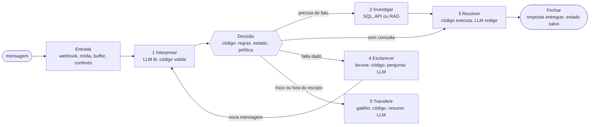
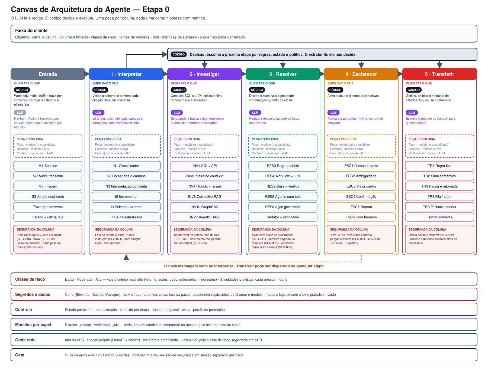
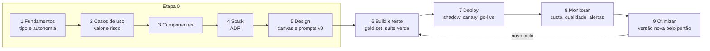

# MP AI Platform

**Framework de arquitetura para agentes conversacionais em produção.** Transforma o problema de um cliente em um agente desenhado, medido e publicado, sem partir de um fluxo pronto e sem deixar o modelo decidir o que o código deveria decidir.

> **O LLM lê e redige. O código decide e executa.**

Nasceu de agentes reais de atendimento no WhatsApp (clínicas, varejo, distribuição B2B, hotelaria e serviços) e foi escrito para resolver o que mais quebrava neles: o "sim" interpretado fora de contexto, a correção que não substituía o dado antigo, a transferência que não acontecia (ou acontecia quando não devia) e o mesmo bug voltando depois de corrigido.

---

## Sumário

- [O turno: seis etapas com contrato fixo](#o-turno-seis-etapas-com-contrato-fixo)
- [As cinco capacidades](#as-cinco-capacidades)
- [Catálogo de peças](#catálogo-de-peças)
- [Etapa 0 e o canvas](#etapa-0-e-o-canvas)
- [Porte do agente: P, M ou G](#porte-do-agente-p-m-ou-g)
- [Ciclo de vida: as 9 fases](#ciclo-de-vida-as-9-fases)
- [Qualidade: todo erro vira caso](#qualidade-todo-erro-vira-caso)
- [Segurança](#segurança)
- [Stack de referência](#stack-de-referência)
- [Implementação de referência](#implementação-de-referência)
- [Documentação completa](#documentação-completa)

---

## O turno: seis etapas com contrato fixo

A cada mensagem, o agente percorre só as etapas que o turno precisa. O que cada etapa **recebe e entrega** é fixo; as peças que cumprem o contrato (modelo, tipo de RAG, orquestrador) são intercambiáveis. Por isso dá para trocar o modelo ou a estratégia de busca sem refazer o agente.



Transferir pode ser disparado de qualquer etapa. Por baixo de tudo corre a **camada de controle**: estado por evento, orquestração, contexto por etapa, traces e evals.

O ponto central é a **Decisão**: o extrator tem inteligência máxima para ler e autoridade zero para decidir. A saída dele não tem campo de "próximo passo" nem de "transferir". Quem decide é uma função de código, determinística e testável, que aplica uma ordem fixa de autoridade:

1. evidência determinística
2. estado da conversa
3. interpretação do LLM **com citação literal** da conversa
4. na dúvida, abster-se e esclarecer

## As cinco capacidades

| Capacidade | Pergunta que responde | Quem faz o quê | Entrega |
| --- | --- | --- | --- |
| **Interpretar** | O que a pessoa está comunicando, no contexto e no domínio? | LLM lê, código valida | Interpretação estruturada, com evidência citada |
| **Investigar** | Que fatos, regras ou registros precisam ser consultados? | Código, conectores, retrieval; LLM quando preciso | Evidências autorizadas, atuais e rastreáveis |
| **Resolver** | O que deve ser feito, dentro das regras? | Código executa, LLM redige | Resposta fundamentada ou ação executada |
| **Esclarecer** | O que falta ou está ambíguo, e qual a pergunta de menor esforço? | Código acha a lacuna, LLM formula | Uma pergunta objetiva, ou confirmação necessária |
| **Transferir** | Quando e como outra pessoa deve assumir? | Política + máquina de estados | Handoff explícito, com resumo, rastreável e retomável |

Capacidade não é produto: "Investigar" não significa RAG obrigatório, e "Transferir" não significa só chamar um atendente. Cada uma é uma responsabilidade com contrato. Os detalhes estão em [`docs/04-interpretar.md`](docs/04-interpretar.md) a [`docs/08-transferir.md`](docs/08-transferir.md).

## Catálogo de peças

Para cada etapa existe um catálogo de peças, cada uma com **o que resolve, quando escolher, quando não escolher e o que exige das outras**. Alguns exemplos:

| Etapa | Peças | Exemplos |
| --- | --- | --- |
| Entrada | M1–M3, B1–B3 | só texto, áudio transcrito, imagem; buffer e janela deslizante; trava por conversa |
| Interpretar | N1–N3, I1–I9 | classificador, comandos e campos, interpretação completa; extração incremental, seletor + extrator, saída estruturada |
| Investigar | INV1–INV12 | SQL/API direto, base inteira no contexto, busca híbrida com rerank, Corrective RAG, GraphRAG, Agentic RAG |
| Resolver | RES1–RES8 | regra/tabela, workflow + LLM, gera + verifica, agente com teto, ação governada |
| Esclarecer | ESC1–ESC6 | campo faltante, ambiguidade, maior ganho de informação, confirmação, reparo, com humano |
| Transferir | TR1–TR6 | regra fixa, sinal semântico, pausa e retomada, fila por setor, fallback por timeout |

A regra é escolher a peça **mais simples que passa no gold set**. Uma peça mais sofisticada só entra quando a simples perde na medição.

## Etapa 0 e o canvas

Nenhum prompt é escrito antes da Etapa 0. Ela vai do escopo ao gate em dez passos: pasta e quadro, escopo, skills, questionamentos, estrutura do repositório e segredos, mapa de dados (leitura de 50 a 100 conversas reais), desenho, ADRs, testes antes do código e o gate assinado em duas sessões, uma delas de segurança.

O desenho acontece no **Canvas de Arquitetura do Agente**: uma coluna de entrada, cinco colunas de etapa e as faixas de cliente, segurança, controle, modelos e onde roda. Em cada coluna entra **uma peça**, e cada peça entra como **hipótese com métrica e alvo**, contrato versionado e ADR.



O arquivo editável está em [`diagramas/canvas-agente.excalidraw`](diagramas/canvas-agente.excalidraw) (abre no VS Code com a extensão Excalidraw ou em excalidraw.com). O plano de construção sai do quadro: cada coluna preenchida vira uma fase, com entrega e teste próprios. Ver [`docs/02-etapa-0.md`](docs/02-etapa-0.md).

## Porte do agente: P, M ou G

Primeira decisão do desenho. O porte define onde o agente roda, quanto de observabilidade, eval, guardrail e rollout ele exige. **Vale o critério mais alto**: um único critério G faz o agente G.

| Critério | P | M | G |
| --- | --- | --- | --- |
| Volume | até ~1.000 conversas/mês | 1.000 a 20.000 | acima de 20.000 |
| Etapas com LLM | 1 ou 2 | 3 ou 4 | 5+ ou multiagente |
| Ações | leitura e transferência | escrita reversível | escrita irreversível ou financeira |
| Dado | sem dado pessoal relevante | dado pessoal comum | dado sensível (saúde, financeiro) |
| Autonomia | N0–N1 | N1–N2 | N2–N3 |

| Exige | P | M | G |
| --- | --- | --- | --- |
| Evals | gold set v0 + suíte de erros | + simulação de cenários e A/B | + juiz online e red team |
| Rollout | shadow curto, depois total | shadow e canary | shadow, canary por % e expansão |
| Segurança | matriz A–J + suíte SEC | + modelagem de ameaças | + revisão separada e red team antes do go-live |

## Ciclo de vida: as 9 fases

O framework tem dois eixos ao mesmo tempo: as **seis etapas do turno** (o que o agente faz a cada mensagem) e as **nove fases do ciclo de vida** (como o projeto nasce, entra em produção e melhora). Uma fase só fecha quando produziu o que cada uma das seis etapas precisa.



## Qualidade: todo erro vira caso

- **Suíte de erros.** Cada bug encontrado, em produção, em eval ou com o cliente, vira um arquivo YAML com a menor conversa que o reproduz e a conduta esperada. A suíte inteira roda antes de toda publicação. É o que impede corrigir a mesma coisa duas vezes.
- **Gold set.** Peças e modelos concorrem no mesmo conjunto rotulado. O que ganha entra; o que perde fica registrado como alternativa descartada.
- **Capacidade e regressão têm alvos opostos.** O conjunto de capacidade mede o que ainda não funciona; o de regressão fica perto de 100%, e qualquer queda indica quebra.
- **Portão de promoção.** Uma versão nova só substitui a atual se passar na suíte de erros, não piorar o gold set e respeitar o teto de custo e latência.

Ver [`docs/13-evals-e-otimizacao.md`](docs/13-evals-e-otimizacao.md).

## Segurança

Doze casos de segurança obrigatórios (SEC-001 a SEC-012) entram na suíte antes da primeira linha de código: "sim" lido fora de contexto, instrução injetada na mensagem ou num documento recuperado, tentativa de ler dado de outro cliente, pedido de segredo, mensagem reenviada, requisições simultâneas e ação com consequência sem confirmação. A seção de segurança cobre limites de confiança, prompt injection, segredos em cofre, anonimização antes de chamar modelo, exfiltração, MCP e cadeia de suprimentos, mapeados para o **OWASP Top 10 para Aplicações Agênticas (2026)** e o **OWASP MCP Top 10**.

Ver [`docs/15-seguranca.md`](docs/15-seguranca.md). A matriz completa de controles da plataforma (seções A a Q, prioridades P0 a P3) está no [Framework de Plataformas](https://github.com/mathpr9-code/framework-plataformas/blob/main/docs/seguranca/matriz-de-seguranca.md).

## Stack de referência

| Camada | Opções avaliadas no framework |
| --- | --- |
| Orquestração | LangGraph, n8n, código próprio |
| Serviço | FastAPI + worker |
| Estado e memória | Postgres/Supabase, pgvector, Valkey/Redis |
| Observabilidade | Langfuse, LangSmith, OpenTelemetry, Grafana |
| Evals | gold set próprio, promptfoo, simulação de cenários |
| Onde roda | n8n em VPS, DigitalOcean App Platform, Azure Container Apps, AWS (ECS, Bedrock AgentCore) |

A escolha é por porte e fica registrada em ADR. Ver [`docs/10-construcao-e-stack.md`](docs/10-construcao-e-stack.md) e [`docs/11-onde-roda-e-deploy.md`](docs/11-onde-roda-e-deploy.md).

## Implementação de referência

[`referencia/`](referencia/) traz, em Python, as duas ideias que mais mudaram a qualidade dos agentes:

- **A camada de decisão como função pura** (`decide()`): recebe a interpretação, o estado e a conversa e devolve uma conduta. Sem LLM, sem I/O.
- **A suíte de erros como dado**: dez casos YAML (quatro da suíte de segurança e seis de regressão), todos passando.

```bash
cd referencia
pip install -e ".[dev]"
pytest -v
```

## Documentação completa

O framework inteiro, sem resumo, está em [`docs/`](docs/). A leitura é de ponta a ponta: as seções se referenciam e uma decisão em uma fase muda as outras.

| # | Documento | O que cobre |
| --- | --- | --- |
| 00 | [Como funciona](docs/00-como-funciona.md) | os sete movimentos, as 9 fases, matriz fase × etapa, mapa da arquitetura |
| 01 | [Fundamentos e casos de uso](docs/01-fundamentos-e-casos-de-uso.md) | o que é um agente, níveis de autonomia, componentes, seleção de casos de uso |
| 02 | [Etapa 0](docs/02-etapa-0.md) | passo a passo, roteiro de descoberta, mapa de dados, porte, canvas, gate |
| 03 | [Entrada](docs/03-entrada.md) | mídia, buffer, trava por conversa, carga de estado |
| 04 | [Interpretar](docs/04-interpretar.md) | níveis N1–N3, extratores I1–I9, evidência literal |
| 05 | [Investigar](docs/05-investigar.md) | SQL/API, RAG em todas as variantes, INV1–INV12 |
| 06 | [Resolver](docs/06-resolver.md) | regra, workflow, gera + verifica, ação governada |
| 07 | [Esclarecer](docs/07-esclarecer.md) | campo faltante, ambiguidade, confirmação, reparo |
| 08 | [Transferir](docs/08-transferir.md) | gatilhos, pausa e retomada, fila, fallback |
| 09 | [Conduta e persona](docs/09-conduta-e-persona.md) | tom, persona, regras de conversa |
| 10 | [Construção e stack](docs/10-construcao-e-stack.md) | o que a documentação oficial de cada stack diz |
| 11 | [Onde roda e deploy](docs/11-onde-roda-e-deploy.md) | hospedagem, custo, rollout |
| 12 | [Camada de controle](docs/12-camada-de-controle.md) | orquestração, contexto, estado, observabilidade, monitoramento |
| 13 | [Evals e otimização](docs/13-evals-e-otimizacao.md) | suíte de erros, gold set, graders, portão de promoção |
| 14 | [Montagem e seleção](docs/14-montagem-e-selecao.md) | ordem de montagem, composições de referência, ADR, checklist |
| 15 | [Segurança](docs/15-seguranca.md) | OWASP agêntico e MCP, segredos, limites de confiança, testes |
| — | [Fontes](docs/fontes.md) | documentação oficial e referências usadas em cada decisão |

---

**Autor:** Matheus Pereira Ribeiro · AI Automation Engineer · [LinkedIn](https://www.linkedin.com/in/matheuspereiraribeiro) · [GitHub](https://github.com/mathpr9-code)

Exemplos e casos usam dados fictícios. Nenhum dado de cliente está neste repositório.
