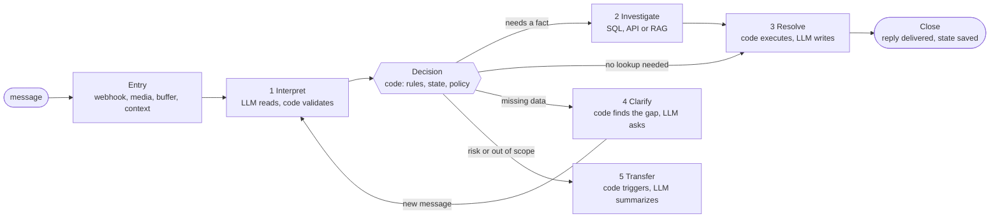
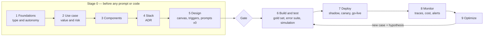

# MP AI Platform — a framework for conversational agents that work in production

> **The LLM reads and writes. The code decides and executes.**

MP AI Platform is the architecture framework I use to design, build, measure and evolve conversational AI agents (WhatsApp customer service, sales and support). It is the distilled result of building and operating **11+ agents in production, with 17,000+ conversations handled**, and of the bugs those conversations exposed.

It is not a prompt, a template or a specific flow. It is a set of **fixed contracts**, a **catalog of interchangeable pieces** for each contract, and a **measurement method** that decides which piece wins for each client.

This repository contains:

| Path | What it is |
| --- | --- |
| [`README.md`](README.md) | The framework in one read: the turn, the five capabilities, the lifecycle, the evaluation rules |
| [`docs/capabilities.md`](docs/capabilities.md) | Deep dive into each stage: contracts, catalog of pieces, failure modes, metrics |
| [`docs/lifecycle.md`](docs/lifecycle.md) | Stage 0, agent sizing, the 9-phase lifecycle and the gate before any code |
| [`docs/evaluation.md`](docs/evaluation.md) | Error suite, gold sets, sample size, graders, promotion gate, scenario simulation |
| [`docs/security.md`](docs/security.md) | Trust boundaries, prompt injection, secrets, privacy, mandatory security cases |
| [`reference/`](reference/) | A small, runnable Python implementation of the decision layer and the error suite |

---

## Why this exists

My first agents followed the common pattern: receive the message, send it to the LLM, let the model decide what to do. It worked until the flows grew. Then the same problems kept coming back:

- The customer answers **"yes"** to *"Anything else I can help with?"* and the agent transfers to a human, because the "yes" was read without the question that caused it.
- A change in one part of the prompt silently breaks behavior somewhere else.
- The agent says *"your appointment is confirmed"* when no system ever confirmed it.
- The same bug is fixed twice, because nothing remembers it was fixed the first time.

None of these are model-quality problems. They are **architecture** problems: decisions living inside the model, state that is not explicit, and no memory of past failures. This framework moves each responsibility to where it can be controlled and measured.

---

## The core idea in three rules

1. **The LLM has maximum intelligence to read and zero authority to decide.** It interprets language and writes replies. Business rules, state, permissions, transfers and actions belong to code.
2. **Contracts are fixed; pieces are interchangeable.** What each stage receives and returns never changes between clients. Which model, which retrieval strategy or which orchestrator fulfils it can change, without rebuilding the agent.
3. **Nothing is true until measured, and every error becomes a test.** Pieces and models compete on the same gold set. Every bug found becomes a case in the error suite, and nothing is published unless the whole suite passes.

---

## How a turn works

Every message goes through an **entry** layer (pure code) and then through up to five capabilities. They are responsibilities, not five LLM calls in a row: a greeting may only need *Interpret* and a reply; a factual question needs *Interpret → Investigate → Resolve*.



Transfer can be triggered from any stage. Underneath everything runs a **control layer**: state, orchestration, context per stage, traces and evals.

### Entry: most "extractor errors" are born here

Before any model sees the message, code does six things: **receive** (validate the webhook and acknowledge immediately), **deduplicate** (provider retries must not become a second reply), **normalize** (transcribe audio, read images and documents, and mark where each text came from), **buffer** (join the three messages a person sends for one sentence into a single turn), **lock** (one execution per conversation at a time) and **load** (history with author and order, state, open questions and the agent's last message).

### The turn is a pair

A short answer only means something together with the question that caused it. So every time the agent asks something, **code records what that question opened**:

```json
{
  "turn": "t7",
  "author": "agent",
  "text": "Anything else I can help you with?",
  "open_question": {
    "id": "q7",
    "kind": "yes_no",
    "about": "continue_conversation",
    "on_yes": "await_new_request",
    "on_no": "close_conversation"
  }
}
```

The extractor receives that last message and returns *which question the reply answers*. Code then applies exactly the effect recorded for that answer, and only that effect:

| The agent said | Customer replied | Read in isolation (wrong) | Read as a pair (right) |
| --- | --- | --- | --- |
| "Anything else I can help with?" | "yes" | Asks for a human | Wants to continue; ask what |
| "Want me to connect you to an agent?" | "yes" | Generic confirmation | Accepted the transfer offer |
| "Shall I confirm Saturday at 10am?" | "no" | Close | Refused; ask what to change |
| Showed two options | "the second one" | Meaningless | Chose option 2 |
| No open question | "ok" | Confirms something | Receipt only; triggers nothing |

Two rules close the gap for good: **a short reply with no open question never triggers an action**, and **a semantic trigger (like asking for a human) requires an explicit act anchored in a literal quote**.

---

## The five capabilities

| Capability | Functional question | Who does what | Output |
| --- | --- | --- | --- |
| **1. Interpret** | What is the person communicating, given language, context and domain? | LLM reads; code validates schema, quotes and deterministic evidence | A structured, evidence-backed interpretation |
| **2. Investigate** | Which facts, rules or records do we need? | Code chooses the source; SQL/API, search or RAG retrieve | Authorized, current, traceable evidence |
| **3. Resolve** | What should be done, within the rules? | Code decides and executes; LLM writes from a structured act; code verifies | A grounded answer or a confirmed action |
| **4. Clarify** | What is missing, and which question closes it with the least effort? | Code detects the gap; LLM phrases the question | One objective question or confirmation |
| **5. Transfer** | When and how should someone else take over? | Policy and state machine decide; LLM writes the summary | Explicit, traceable, resumable handoff |

### 1. Interpret: a translator, not a decision maker

The extractor turns free language into a closed vocabulary that code understands. A simple boundary test decides what belongs to it: *would two people, reading only the conversation and the glossary, without knowing the business rules, reach the same value?* If yes, it is an extractor field (*"the customer corrected the date from Friday to Saturday"*). If it depends on a rule or a system, it is a code field (*"can be rescheduled"*, *"must be transferred"*).

```json
{
  "evidence": [{"id": "ev1", "turn": "t18", "quote": "actually we are 5"}],
  "acts": ["correction"],
  "intent": "change_reservation",
  "fields": [{"name": "party_size", "value": 5, "origin": "explicit", "evidence": "ev1"}],
  "corrections": [{"field": "party_size", "from": 4, "to": 5, "evidence": "ev1"}],
  "ambiguities": [],
  "out_of_list": false
}
```

What code does with it: validates schema and enums, **checks that every quote exists literally in the cited turn**, cross-checks deterministic evidence (IDs, dates, codes by regex; on conflict, deterministic wins), applies changes to state **as events, never by overwriting**, and only then decides. Business rules, transfer criteria, tool lists and persona never go into the extractor's prompt.

When the extractor fails, the levers are pulled in this order: **contract** (field definitions with contrastive examples), **context** (did the agent's last question arrive?), **room to think** (reasoning effort, evidence fields before conclusions), **decomposition**, and only then **a bigger model** or **fine-tuning**.

### 2. Investigate: start with "where does this fact live?"

Investigate is wider than RAG. The choice follows a ladder; you only go down a step when the current one misses the target on the retrieval gold set:

| Step | Signal | Piece |
| --- | --- | --- |
| 0 | Simple, stable rule | Code or versioned config, no search |
| 1 | The fact is a live record (order, schedule, account) | SQL or API |
| 2 | Small, stable knowledge base | Whole base in context, with caching |
| 3 | Exact codes, names, terms | Lexical search (BM25) |
| 4 | Same thing said many ways | Vector search |
| 5 | Both signals at once | Hybrid search + reranking |
| 6 | Questions across relations or the whole corpus | GraphRAG |
| 7 | Next search depends on the previous one | Agentic RAG, with a step limit |

Around the search, **Corrective RAG** (implemented as a LangGraph graph) evaluates what came back and rewrites the query or tries another source before generating, so "not found" becomes *clarify* or *transfer* instead of an invented answer. Every result carries source, version, authority, timestamp and a status (`found`, `insufficient`, `conflict`, `stale`, `no_access`). Resolve never receives loose text.

### 3. Resolve: code decides, the LLM writes

Resolve is four steps with different owners: **decide** (code, rule table or state machine), **execute** (code, with validation and idempotency), **write** (LLM, from a structured act) and **verify** (code first, an LLM judge only for semantic criteria).

```json
{
  "act_id": "a1",
  "action": "confirm_change",
  "facts": [{"fact_id": "f1", "origin": "machine:reservations_api", "text": "reservation changed to 5 people"}],
  "must_contain": ["5 people"],
  "must_not": ["promise a specific table"]
}
```

The writer may only state what is in `facts`. If the verifier rejects the text, there is one retry; if it fails again, a deterministic fallback text is sent. **The customer never receives wrong information and is never left without an answer.** And no action is ever narrated as done without confirmation from the system that executed it.

### 4. Clarify: the minimum question

Code decides that something is missing; the LLM only phrases the question. Before asking, code checks: is it already in the history or state? Can a system answer it? Is the customer the right person to answer, or is the gap internal (then it goes to Transfer)? Defaults to calibrate per client: one question per turn, two attempts at the same gap before transferring, and a list of actions that require confirmation.

### 5. Transfer and close: a decision machine

Every conversation ends in one of three states decided by code: **resolved and closed**, **transferred to a human**, or **abandoned by timeout**. Mandatory triggers (out of scope, human authority, risk above the limit, persistent failure) are rules in code, measured by recall. Semantic triggers (asking for a human, dissatisfaction) are acts flagged by the extractor and applied by policy. **The extractor never returns "transfer".** The handoff package (reason, priority, queue, factual summary, evidence, actions already executed, open points) is assembled from state; only the summary is written by the LLM.

---

## The lifecycle: from a client problem to an agent in production

Two axes run at the same time: the **six stages of the turn** say what the agent does with each message; the **nine phases of the lifecycle** say how the agent is born, goes to production and improves.



**Stage 0 is mandatory.** No prompt, model or flow is created before four jobs are done: repository and agent skills set up, data mapped (sources, owners, and 50 to 100 real conversations read and annotated), architecture drawn on a canvas (one piece per stage, each as a hypothesis with a metric), and a gate signed, including the security review. The canvas also fixes the **agent's size** (S, M or L by volume, LLM stages, actions, integrations, data sensitivity and autonomy), which sets how much observability, evaluation, guardrails and rollout the agent needs. Details in [`docs/lifecycle.md`](docs/lifecycle.md).

---

## Evaluation: nothing is published without proof

- **Error suite.** Every error found becomes a case, stored as data (one YAML file), run by a single test runner. The case is written *before* the fix and must fail on the current version. Cases are never deleted. Decision cases run without any model, in milliseconds.
- **Mandatory security cases** exist from day one: "yes" after a closing question, "ok" with nothing open, prompt injection in the customer message and in retrieved documents, another tenant's ID, personal data in traces, actions narrated without confirmation, duplicated provider messages, concurrent requests.
- **Gold sets per stage.** Each stage is measured alone before the whole, so you know where to fix. Capability suites start with low scores; regression suites stay near 100%.
- **Honest sample sizes.** At a 90% hit rate, 100 cases give about ±6 points: you cannot tell 90% from 94%. Splits are by conversation, never by turn.
- **Promotion gate.** Critical cases with zero tolerance, full error suite and regression green, paired gain on the slice that motivated the change, and cost and latency within budget.

Full method in [`docs/evaluation.md`](docs/evaluation.md).

---

## Try it: the reference implementation

[`reference/`](reference/) is a deliberately small Python implementation of the two ideas that matter most: **the decision layer as a pure function** and **the error suite as data**.

```bash
cd reference
python -m venv .venv && source .venv/bin/activate   # Windows: .venv\Scripts\activate
pip install -e ".[dev]"
pytest -v
```

```text
tests/error_suite/test_error_suite.py::test_error_case[ERR-0042] PASSED
tests/error_suite/test_error_suite.py::test_error_case[SEC-001] PASSED
...
10 passed
```

Each test is one YAML file in [`reference/tests/error_suite/cases/`](reference/tests/error_suite/cases/). To register a new bug, add a file; no test code needed. Try breaking a rule in [`decision.py`](reference/src/mp_agent/decision.py) (for example, remove the open-question check) and watch `SEC-001` fail.

---

## Default stack

The framework does not fix a runtime; the stack below is the default, and changing any line requires an ADR.

| Layer | Default | Alternative |
| --- | --- | --- |
| Language / API | Python, FastAPI | TypeScript |
| Turn runtime | LangGraph | Microsoft Agent Framework |
| Retrieval | Own code over pgvector | LlamaIndex for complex documents |
| State and history | Managed Postgres next to the runtime | Supabase |
| Buffer, lock, cache | Valkey / Redis | — |
| Observability | Langfuse (plan by agent size) | LangSmith, Phoenix; Grafana for infra |
| Hosting | n8n on a VPS for small agents; DigitalOcean App Platform for services | Azure Container Apps, AWS ECS |
| Models | Chosen per stage on the gold set (GPT, Claude, Gemini via API) | — |

---

## Status

The framework is a living document: it is revised as each new agent exposes a new failure. Open questions (extractor intelligence vs. latency, when to leave n8n for a dedicated service, evaluation automation) are tracked in the private working version.

## Author

**Matheus Pereira Ribeiro** — AI Engineer, São Paulo, Brazil.
[LinkedIn](https://www.linkedin.com/in/matheuspereiraribeiro) · [GitHub](https://github.com/mathpr9-code)
