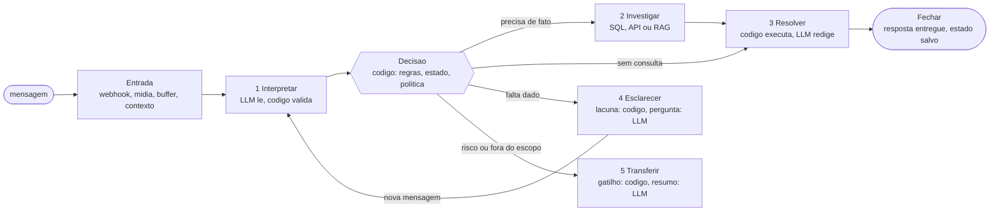

# Como funciona o framework

O framework transforma o problema de um cliente em um agente construído, medido e publicado, sem partir de um fluxo pronto. Ele funciona em sete movimentos:

1. **Começa pelo problema.** O que o cliente precisa, como o atendimento dele funciona, que dados existem e o que não pode dar errado.
2. **Etapa 0.** Antes de qualquer prompt: instalar as skills, mapear os dados, classificar a classe de risco do agente, desenhar a arquitetura no quadro (Excalidraw ou Figma) e passar no gate. O desenho e a classe de risco decidem tamanho, robustez, dificuldades e o custo de tudo que vem depois.
3. **O quadro.** Uma coluna de entrada, cinco colunas de etapa (Interpretar, Investigar, Resolver, Esclarecer, Transferir) e as faixas de controle, modelos e onde roda. Em cada coluna você escolhe uma peça do catálogo.
4. **Cada peça tem por quê e para quê.** O catálogo diz o que a peça resolve, quando escolher, quando não escolher e o que ela exige das outras. A escolha vira hipótese com métrica.
5. **Os contratos não mudam.** O que cada etapa recebe e entrega é fixo. Por isso dá para trocar o modelo, o tipo de RAG ou o orquestrador sem refazer o agente.
6. **Nada é verdade até ser medido.** Peças e modelos concorrem no mesmo gold set. O que ganha entra; o que perde fica registrado como alternativa descartada.
7. **Todo erro vira caso.** A suíte de erros roda antes de toda publicação. É o que impede o retrabalho de corrigir a mesma coisa duas vezes.

O plano de construção sai do quadro: cada coluna preenchida vira uma fase, com entrega e teste próprios.

# Ciclo de vida do agente — as 9 fases

O framework tem dois eixos, e os dois valem ao mesmo tempo:

- **As seis etapas do turno** (Entrada, Interpretar, Investigar, Resolver, Esclarecer, Transferir) dizem o que o agente faz a cada mensagem. É o eixo de execução.
- **As nove fases do ciclo de vida** dizem como o projeto do agente nasce, entra em produção e melhora. É o eixo de construção.

Uma fase não substitui uma etapa. Cada fase produz alguma coisa para cada uma das seis etapas, e a matriz abaixo diz o quê. Uma fase só fecha quando a linha dela estiver preenchida para as seis etapas.

## As nove fases

| Fase | Pergunta que responde | Entrega | Onde está neste documento |
| --- | --- | --- | --- |
| 1. Fundamentos | Que tipo de agente é este e quanta autonomia ele tem? | Classificação do agente: tipo e nível de autonomia (N0 a N4) | Fundamentos — o que é um agente |
| 2. Casos de uso | Vale construir? Qual problema, para quem, com que valor? | Ficha do caso de uso com nota de valor e risco | Casos de uso — catálogo e seleção |
| 3. Componentes | Que peças o agente precisa ter? | Lista de componentes ativos, com dono | Fundamentos → Os componentes e onde moram; Partes D e H |
| 4. Stack | Com que tecnologia cada peça é construída? | ADR de stack | Stack — fichas por família |
| 5. Design | Como o agente se comporta e quando ele dispara? | Canvas, fichas por capacidade, ficha de gatilhos, prompts v0 | Etapa 0 → Checklist de design |
| 6. Build e teste | Funciona e não regrediu? | Código, gold set, suíte de erros verde, simulação de cenários | Partes C, D e I |
| 7. Deploy | Como entra em produção sem quebrar? | Ambiente, pipeline, plano de rollout, go-live assinado | Deploy — hospedagem, rollout e go-live |
| 8. Monitorar | Está funcionando agora, e quanto custa? | Dashboards, alertas, relatório semanal | Camada de controle → Monitoramento em produção |
| 9. Otimizar | Como fica melhor, mais rápido e mais barato? | Versão nova promovida pelo portão | Otimização contínua |

As fases 1 a 5 acontecem dentro da Etapa 0. A fase 6 é a construção fase a fase do quadro. As fases 7 a 9 são um laço: o que o monitoramento encontra vira caso na suíte de erros e hipótese de otimização, que volta pelo portão e por um novo deploy.

## Matriz fase × etapa

| Fase | Entrada | 1 Interpretar | 2 Investigar | 3 Resolver | 4 Esclarecer | 5 Transferir |
| --- | --- | --- | --- | --- | --- | --- |
| 1. Fundamentos | Reativo (mensagem) ou proativo (agenda, evento) | O LLM lê; o código decide (N1 é o padrão) | Busca fixa (N1) ou busca autônoma (N2 a N3) | Ação disparada por código ou ferramenta escolhida pelo LLM em lista fechada | Pergunta mínima, nunca planejamento aberto | A autonomia acaba onde começa o risco |
| 2. Casos de uso | Canal, volume e horário do caso | Intenções e campos do domínio | Fontes de fato do caso | Ações que geram o valor do caso | Lacunas típicas do caso | Casos de tolerância zero |
| 3. Componentes | Buffer, trava, memória curta | LLM e schema de saída | Ferramentas de leitura, recuperação, memória longa | Ações, guardrails de execução e de saída | Estado de pendência | Humano no circuito, laço de feedback |
| 4. Stack | Servidor de webhook, fila, Valkey ou Redis | Modelo do extrator, saída estruturada | pgvector ou Pinecone; LlamaIndex se a ingestão for pesada | LangGraph ou Microsoft Agent Framework; Tool Registry | Checkpointer e interrupt | Integração com a plataforma de atendimento, outbox |
| 5. Design | Ficha de gatilhos, janela de buffer | Schema e intenções no canvas | Mapa de dados com autoridade por fonte | Atos, regras e limites | Política de perguntas | Gatilhos TR e pacote de handoff |
| 6. Build e teste | Casos SEC de duplicata e concorrência | Suíte do extrator | Suíte de recuperação | Verificador do redator, testes de ação | Casos de lacuna | Casos de handoff e de entrega |
| 7. Deploy | Webhook autenticado, rate limit | Versão do prompt por rótulo | Índice versionado, ingestão agendada | Ação real só depois do shadow | Herda o plano de rollout do agente | Fila humana pronta antes do go-live |
| 8. Monitorar | Latência de recebimento, mensagem perdida | Schema inválido, abstenção | Ausência de fonte, recall | Erro de ferramenta, custo por turno | Perguntas por conversa | Taxa de transferência, tempo até o humano |
| 9. Otimizar | Janela de buffer | Modelo menor, cache, exemplos | Chunking, reranking | Roteamento de modelo, prompt do redator | Menos perguntas por resolução | Gatilhos recalibrados |

# Como ler este framework

| Camada | O que é | Muda por cliente? |
| --- | --- | --- |
| Contrato | O que cada etapa recebe e entrega (schema, estado, eventos) | Não |
| Peça | A técnica que cumpre o contrato (tipo de extrator, de recuperação, de orquestração) | Sim |
| Medida | O número que prova que a peça serve para aquele cliente | O alvo muda; o método não |

Três regras valem para todas as etapas:

1. **Nenhuma peça é verdade.** Toda escolha entra no canvas como hipótese, com a métrica que a confirma ou derruba.
2. **Comece pela peça mais simples que cumpre o contrato.** Só suba de complexidade quando o eval mostrar o teto da peça atual.
3. **Cada etapa é medida sozinha antes do conjunto.** Sem medida por etapa você não sabe onde consertar.

Cada etapa segue a mesma ordem: papel, contrato, peças, quando cada peça encaixa, como medir e modos de falha. As cinco etapas são responsabilidades, não cinco chamadas de LLM em sequência.

# Como usar no Claude Code

O framework é escrito para ser seguido por um agente de código. Exporte esta página como `docs/FRAMEWORK.md` no repositório do agente e aponte para ela no `CLAUDE.md`.

Prompt de partida:

```txt
Vamos construir um agente conversacional seguindo docs/FRAMEWORK.md.

Cliente: <nome e negócio>
Canal: <ex.: WhatsApp>
Objetivo: <o que o agente resolve>
Material disponível: <conversas, documentos, APIs, acessos>

Regras de trabalho:
0. Leia docs/FRAMEWORK.md inteiro antes de qualquer outro passo. Confirme a leitura
   listando as 9 fases do ciclo de vida e as 6 etapas do turno.
1. Execute a Etapa 0 inteira antes de escrever qualquer prompt ou código:
   setup e skills, descoberta (use /grill-me), mapa de dados, canvas, gold set v0, gate.
2. Para cada uma das cinco etapas, proponha pelo menos duas peças do catálogo
   e dois modelos candidatos, com a hipótese e a métrica que decide entre eles.
3. Nenhuma peça ou modelo é fixo: a escolha sai da comparação no mesmo gold set.
4. Registre cada decisão como ADR em docs/architecture/decisions/.
5. Implemente uma fase por vez; rode a suíte da etapa e a regressão antes de seguir.
6. Instrumente tracing desde a primeira chamada de modelo.
7. Ao fim de cada sessão, atualize docs/plans/handoff.md.
8. O que não estiver no material do cliente é pendência, não suposição: pergunte.
```

O que o agente de código entrega em cada fase:

| Fase | Entrega | Onde |
| --- | --- | --- |
| Etapa 0 | Repositório configurado, `PRODUCT.md`, glossário, mapa de dados, canvas, gold set v0 | Raiz e `docs/` |
| Entrada | Webhook, tratamento de mídia, buffer, trava por conversa, carga de estado e da última fala do agente | `src/`, `tests/` |
| Interpretar | Schema do extrator, prompt, validador em código, suíte do extrator | `src/`, `tests/`, `docs/quality/` |
| Decisão | Função pura de decisão e gold set de decisão | `src/`, `tests/` |
| Investigar | Conectores ou índice, contrato de evidência, suíte de recuperação | `src/`, `tests/` |
| Resolver | Atos, redator, verificador, execução de ações | `src/`, `tests/` |
| Esclarecer e Transferir | Regras de lacuna, gatilhos, pacote de handoff, entrega | `src/`, `docs/policies/` |
| Controle | Estado por evento, tracing, evals em rotina, portão de promoção | `src/`, `docs/quality/` |

# Mapa da arquitetura

O LLM lê e redige; o código decide e executa.



Transferir pode ser disparado de qualquer etapa; o desenho mostra o caminho principal. Por baixo de tudo corre a camada de controle: estado, orquestração, contexto por etapa, traces e evals.

## O ciclo não é uma esteira rígida

O agente percorre as etapas conforme a necessidade do turno. O ciclo pode avançar, retornar ou encerrar.

```txt
Mensagem
   ↓
INTERPRETAR
   ↓
Compreensão suficiente?
   ├── Não: ESCLARECER ou TRANSFERIR, conforme a origem da lacuna
   └── Sim
        ↓
É necessário consultar fatos ou sistemas?
   ├── Sim: INVESTIGAR
   └── Não: continuar com evidências já disponíveis
        ↓
Há evidência e autorização suficientes?
   ├── Sim: RESOLVER
   ├── Falta informação que o interlocutor pode fornecer: ESCLARECER
   └── Falta decisão, autoridade ou fonte interna: TRANSFERIR
        ↓
Nova mensagem / resultado de ferramenta / intervenção humana
        └── volta a INTERPRETAR
```

Uma saudação simples pode exigir apenas Interpretar e uma resposta. Uma pergunta factual pode exigir Interpretar, Investigar e Resolver. Uma mensagem ambígua pode exigir Esclarecer e reiniciar o ciclo. Uma solicitação com risco, fora do escopo ou dependente de autoridade humana pode exigir Transferir.

## As cinco capacidades

| Capacidade | Pergunta funcional | Papel predominante | Resultado esperado |
| --- | --- | --- | --- |
| **Interpretar** | O que a pessoa está comunicando, considerando linguagem, contexto e domínio? | LLM + contexto + validação de código | Representação estruturada e fundamentada da comunicação |
| **Investigar** | Que fatos, regras, registros ou evidências precisamos consultar? | Código, conectores, retrieval e, quando necessário, LLM | Conjunto de evidências autorizadas, atuais e rastreáveis |
| **Resolver** | O que deve ser feito para atender à necessidade, dentro das regras? | LLM + código + ferramentas | Solução fundamentada, resultado operacional ou proposta de ação |
| **Esclarecer** | O que ainda falta ou está ambíguo, e qual pergunta resolve isso com menor esforço? | LLM + código + estado conversacional | Pergunta objetiva ou confirmação realmente necessária |
| **Transferir** | Quando e como outra pessoa ou instância deve assumir o caso? | Política + máquina de estados + integração humana | Handoff explícito, contextualizado, rastreável e retomável |

Essas capacidades são responsabilidades, não produtos de software. "Interpretar" não significa obrigatoriamente um único extrator; "Investigar" não significa obrigatoriamente RAG; "Transferir" não significa obrigatoriamente uma biblioteca de grafos.

## Três fronteiras que não podem ser confundidas

1. **Capacidade funcional:** o que o agente precisa realizar, por exemplo interpretar uma correção.
2. **Padrão arquitetural:** como o sistema realiza essa capacidade, por exemplo extração em uma passagem, em duas etapas ou incremental.
3. **Tecnologia de implementação:** qual biblioteca, serviço ou provider materializa o padrão, por exemplo um SDK de modelo, LangChain, LangGraph, Haystack ou código próprio.

O nome da biblioteca não substitui a decisão arquitetural.

## O que este framework é e não é

É: um modelo funcional do atendimento em cinco capacidades; um catálogo de alternativas técnicas para cada uma; um método de seleção e composição baseado nos requisitos do cliente; um sistema de contratos e avaliação que permite trocar uma peça sem reconstruir o agente; uma estrutura para documentar decisões, evidências, riscos e resultados.

Não é: uma sequência fixa de cinco chamadas a LLM; um prompt universal para copiar; uma exigência de usar RAG, agentes autônomos, multiagentes, LangChain ou LangGraph; uma arquitetura montada a partir de um fluxo de produção específico; uma promessa de taxa de acerto.

**Regra de evidência:** uma arquitetura entra no catálogo como alternativa possível, não como recomendação automática. A seleção final exige justificativa, protótipo proporcional ao risco e avaliação no domínio e nas conversas do cliente.
