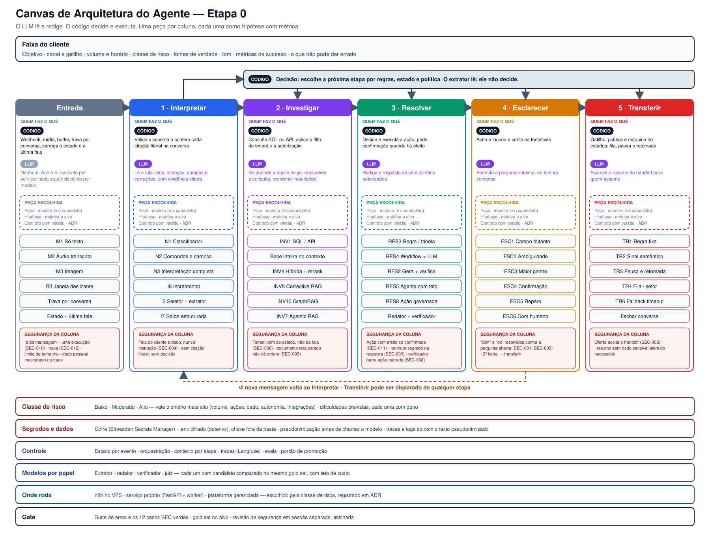

# Etapa 0 — Setup, dados, arquitetura e gate

> 🔒 Etapa obrigatória. Nenhum prompt, modelo ou fluxo é criado antes de quatro trabalhos estarem feitos: instalar as skills e o setup, mapear os dados, desenhar a arquitetura e passar no gate.

| Trabalho | O que entrega | Onde fica registrado |
| --- | --- | --- |
| Instalar skills e setup | Repositório pronto para trabalhar com agente de código, com regras e procedimentos carregados | `CLAUDE.md`, `AGENTS.md`, `docs/agents/`, pasta de skills |
| Mapear os dados | Inventário de fontes e sistemas, mais leitura de conversas reais | `docs/sources/`, `CONTEXT.md`, gold set v0 |
| Desenhar a arquitetura | Canvas com uma peça por etapa, como hipótese com métrica | `docs/architecture/` e ADRs |
| Gate | Revisão e aceite antes do primeiro código | `docs/plans/` |

Toda decisão, regra, limite e plano fica em arquivo. Conversa de chat e memória informal não contam como registro.

## Passo a passo literal da Etapa 0

> 📐 A Etapa 0 é a mesma para agente e para plataforma, e começa sempre pelo quadro. O projeto nasce como uma pasta no VS Code com o arquivo do quadro dentro. Depois vem o escopo, as skills, os questionamentos, as pastas e, por último, o desenho da arquitetura no quadro. Nunca se parte de um quadro em branco.

### Arquivo do quadro (template)

Versão anterior do quadro, antes do teto de custo de modelos. Não use: o arquivo atual está no topo desta página, e este bloco pode ser apagado:

O quadro está em [`diagramas/canvas-agente.excalidraw`](../diagramas/canvas-agente.excalidraw) (editável no VS Code com a extensão Excalidraw, `pomdtr.excalidraw-editor`, ou em excalidraw.com) e renderizado em SVG logo abaixo. Copie para `docs/architecture/diagrams/` do projeto do agente. Para plataforma, o template está no Framework Universal de Construção de Plataformas.



Como abrir: no VS Code, com a extensão Excalidraw (`pomdtr.excalidraw-editor`), o arquivo `.excalidraw` abre direto como quadro editável e continua sendo JSON versionado no Git. Fora do VS Code, abre em [excalidraw.com](http://excalidraw.com) pelo menu Abrir.

### A sequência

| Passo | O que acontece | Quem | Sai daqui |
| --- | --- | --- | --- |
| 0.1 Pasta e quadro | Criar a pasta do projeto, abrir no VS Code, copiar o template do quadro para `docs/architecture/diagrams/` | Responsável | Pasta versionada no Git com o quadro dentro |
| 0.2 Escopo | Dizer o que é o projeto: agente, plataforma ou os dois (dois quadros). Preencher a faixa do cliente em rascunho | Responsável | Faixa do cliente; `PRODUCT.md` v0 com objetivo e o que está fora |
| 0.3 Skills | Instalar as skills do Matt e rodar `/setup-matt-pocock-skills`; acrescentar as skills de modelo e as próprias do projeto | Responsável mais agente de código | Skills instaladas; bloco "Agent skills" no `CLAUDE.md`/`AGENTS.md`; `docs/agents/` |
| 0.4 Questionamentos | Rodar `/grill-me` (ou `/grill-with-docs`) sobre o escopo, cobrindo as seis dimensões da descoberta, até cada decisão fechar ou virar pendência | Agente pergunta, responsável e cliente respondem | Respostas classificadas (observada, informada, hipótese, pendente) em `docs/discovery/`; vocabulário em `CONTEXT.md` |
| 0.5 Pastas | Criar a estrutura completa do repositório e o `docs/FRAMEWORK.md` exportado desta página; configurar os segredos: projeto no gerenciador de segredos, `.env` cifrado com dotenvx e `.env.keys` fora da pasta (seção "Segredos: cofre e .env cifrado") | Agente de código, com o responsável nos segredos | Árvore de pastas da seção "Setup do repositório"; `CLAUDE.md` apontando para o framework; `.env` cifrado no Git e inventário de segredos sem valores |
| 0.6 Dados | Preencher o mapa de dados; ler de 50 a 100 conversas reais | Responsável mais agente | `docs/sources/`; lista de intenções e atos; primeiros casos do gold set |
| 0.7 Desenho | O agente preenche o quadro com o prompt abaixo; o responsável abre, move as caixas e corrige | Agente desenha, responsável aprova | Quadro com uma peça por coluna, modelo por papel, onde roda, segurança por coluna e setas com ponto de autorização; `docs/architecture/canvas.md` |
| 0.8 Registro | Um ADR por escolha material; políticas; plano por fases | Agente | `docs/architecture/decisions/`, `docs/policies/`, `docs/plans/` |
| 0.9 Testes antes do código | Gold set v0 rotulado e os doze casos SEC escritos | Responsável rotula, agente escreve | `docs/quality/`, `tests/error_suite/` |
| 0.10 Gate | Revisão do dono e do revisor de segurança | Responsável, em duas sessões | `docs/plans/gate-0.md` assinado |

Por que nessa ordem: o escopo vem antes das skills porque decide qual quadro e quais skills de modelo entram; as skills vêm antes dos questionamentos porque o `/grill-me` é uma delas; os questionamentos vêm antes das pastas porque é deles que sai o vocabulário e o que cada pasta vai conter; o desenho vem por último porque só dá para escolher peça quando se sabe onde mora cada dado.

Alinhamento com o setup do Matt: o `/setup-matt-pocock-skills` pergunta o issue tracker, os rótulos de triagem e o layout dos documentos de domínio. Responda com arquivos locais (ou o tracker do projeto) e com `CONTEXT.md` como documento de vocabulário. O `CONTEXT.md` é o arquivo de linguagem de domínio do setup do Matt e passa a ser o único glossário do projeto; onde algum trecho antigo citar o glossário, o arquivo é o `CONTEXT.md`.

### Detalhe de cada passo: entradas e saídas

A tabela abaixo detalha os mesmos passos com a numeração da versão anterior, mantida para referência. Correspondência: 0.1 antigo = 0.1, 0.3 e 0.5 novos; 0.2 = 0.5; 0.3 = 0.2 e 0.4; 0.4 = 0.6; 0.5 = 0.7; 0.6 = 0.8; 0.7 = 0.9; 0.8 = 0.10.

| Passo | Quem faz | Entrada | Saída | Onde fica |
| --- | --- | --- | --- | --- |
| 0.1 Criar o repositório e instalar | Responsável mais agente de código | Nome do cliente | Repositório com a estrutura de pastas; skills do Matt instaladas; `/setup-matt-pocock-skills` rodado; `CLAUDE.md` com o bloco de skills | Repositório |
| 0.2 Carregar o framework | Agente de código | Esta página exportada como Markdown | `docs/FRAMEWORK.md` e referência no `CLAUDE.md` | `docs/` |
| 0.3 Descoberta | Responsável com o cliente, usando `/grill-me` | Reunião, documentos, acessos | Respostas das seis dimensões (A a F), classificadas como observada, informada, hipótese ou pendente; `PRODUCT.md` v0 | `PRODUCT.md`, `docs/discovery/` |
| 0.4 Mapear os dados | Responsável mais agente | Fontes do cliente; 50 a 100 conversas reais | Mapa de dados (uma linha por fonte); lista de intenções e atos vistos; `CONTEXT.md` v0; primeiros casos do gold set | `docs/sources/`, `CONTEXT.md`, `docs/quality/gold/` |
| 0.5 Desenhar | Agente desenha, responsável corrige | Template do quadro (seis colunas mais faixas) e as saídas de 0.3 e 0.4 | Quadro preenchido: uma peça por coluna com hipótese e métrica, modelo por papel, onde roda, segurança por coluna, setas com ponto de autorização | `docs/architecture/diagrams/` (fonte editável) e imagem na página do cliente |
| 0.6 Registrar | Agente | Quadro aprovado | Um ADR por escolha material; `docs/policies/`; plano por fases com critério de aceite | `docs/architecture/decisions/`, `docs/plans/` |
| 0.7 Gold set v0 e suíte de segurança | Responsável rotula, agente escreve os arquivos | Conversas de 0.4 | 30 a 50 casos rotulados por etapa; os casos obrigatórios da suíte de segurança (seção de evals) | `docs/quality/`, `tests/error_suite/` |
| 0.8 Gate | Responsável mais revisor de segurança | Tudo acima | Aceite registrado, ou lista do que falta | `docs/plans/gate-0.md` |

### O prompt que pede o desenho (passo 0.7)

```txt
Desenhe a arquitetura deste agente no quadro do framework.

O quadro tem seis colunas fixas, nesta ordem: 0 Entrada, 1 Interpretar, 2 Investigar,
3 Resolver, 4 Esclarecer, 5 Transferir. Embaixo, quatro faixas: Controle, Modelos por papel,
Onde roda, Segurança. Em cima, a faixa do cliente. Não invente colunas.

Use docs/discovery/ e docs/sources/ como fonte. Para cada coluna:
- escolha UMA peça do catálogo (códigos N, I, INV, RES, ESC, TR) e diga por que ela e não as vizinhas;
- escreva a hipótese e a métrica com alvo que a confirma;
- indique o modelo candidato e o concorrente, ou "só código";
- liste os controles de segurança da coluna (Matriz, seção K) e o risco ASI que ela enfrenta.
Para cada seta entre colunas, escreva onde a autorização acontece.
Marque as peças descartadas com o motivo.

Entregue: (1) o arquivo .excalidraw em docs/architecture/diagrams/, (2) uma tabela em
docs/architecture/canvas.md com as mesmas escolhas, (3) a lista de perguntas que você não
conseguiu responder com o material disponível. Não preencha lacunas com suposição.
```

O que o responsável faz com o resultado: abre o quadro, move as caixas, corrige e devolve ao agente com as mudanças. Só depois do aceite do quadro começa o passo 0.6.

### O template do quadro

O template está anexado no início desta seção. Ele é copiado para cada projeto e nunca editado no original: quando o template mudar, a nova versão substitui o anexo e a data é atualizada.

## Ordem

1. **Instalar skills e setup.** Repositório criado, skills instaladas, `/setup-matt-pocock-skills` rodado, arquivos de governo no lugar. Passo a passo em "Setup do repositório".
2. **Descoberta com o cliente.** Seis dimensões: negócio e objetivo; público e conversas; processo de atendimento; conhecimento e fontes; risco e restrições; qualidade e indicadores. Cada informação é classificada como observada, informada e aprovada, hipótese ou pendente.
3. **Mapear os dados.** Preencher o mapa de dados (abaixo) e ler conversas reais. De 50 a 100 conversas do atendimento atual, anotadas à mão. Daqui saem a lista de intenções, o glossário e os primeiros casos de teste.
4. **Desenhar a arquitetura.** No quadro: onde o agente roda, a entrada (mídia e buffer), uma peça por etapa, um modelo por papel e a ferramenta de observabilidade. Cada escolha registrada como hipótese, com ADR das escolhas materiais.
5. **Registrar.** `PRODUCT.md`, `CONTEXT.md`, políticas e plano por fases preenchidos com o que os passos anteriores produziram.
6. **Gold set v0.** De 30 a 50 conversas rotuladas antes do primeiro prompt.
7. **Gate.** Revisão do canvas, dos limites de autoridade e do plano de avaliação.

As faixas de 50 a 100 e de 30 a 50 são pontos de partida; ajuste pelo volume e pela variedade do cliente.

## Roteiro de descoberta com o cliente

A descoberta deve produzir respostas verificáveis em seis dimensões. Ausência de informação não é preenchida com suposição: registre a lacuna, quem pode resolvê-la e se ela bloqueia a arquitetura.

### A. Negócio e objetivo

- Que problema o agente deve resolver?
- Quais resultados o cliente considera sucesso?
- Que tarefas são informativas, consultivas, transacionais ou de suporte?
- O agente deve orientar, consultar sistemas, executar operações ou combinar essas funções?
- O que está explicitamente fora do escopo?

### B. Público e conversas

- Quem conversa com o agente: consumidor, colaborador, parceiro, prestador ou mais de um perfil?
- Quais são os níveis de familiaridade com o assunto?
- Que vocabulário, abreviações, erros de digitação e referências aparecem?
- As pessoas respondem a perguntas anteriores, mudam de assunto, corrigem dados ou enviam várias intenções na mesma mensagem?
- Existem conversas com mais de um participante?
- Quais idiomas, canais e formatos são usados?

### C. Processo de atendimento

- Como o atendimento é conduzido hoje?
- Quais etapas são obrigatórias e quais são exceções?
- Que dados precisam ser conhecidos para avançar?
- O que pode ser resolvido pelo próprio agente?
- Em que momento um humano assume?
- O que deve acontecer depois da transferência?
- O caso pode ser retomado pelo agente após a intervenção humana?

### D. Conhecimento e fontes

- Quais são as fontes oficiais: documentos, FAQ, procedimentos, catálogo, banco, CRM, ERP, APIs ou sistemas externos?
- Qual fonte tem autoridade para cada tipo de fato?
- Há informações dinâmicas, com validade temporal?
- Como tratar divergência entre documentos e sistemas?
- Quem aprova, atualiza e mantém cada fonte?
- Que informações são públicas, internas, sensíveis ou restritas por usuário ou tenant?

### E. Risco, operação e restrições

- Qual é o impacto de uma interpretação errada?
- Que ações podem gerar efeitos externos ou irreversíveis?
- Quais ações exigem aprovação humana?
- Há requisitos de auditoria, privacidade, retenção e segurança?
- Quais são os limites de latência, custo, volume e disponibilidade?
- Quais sistemas precisam ser integrados?

### F. Qualidade e indicadores

- O que significa uma interpretação correta?
- O que significa uma investigação suficiente?
- Como será reconhecida uma solução bem-sucedida?
- Quando uma pergunta de esclarecimento é considerada útil?
- O que configura uma transferência correta?
- Quais métricas são impeditivas para a entrada em produção?

## Artefatos produzidos na descoberta

1. **Agent Brief:** objetivo, público, tarefas, canais, limites e indicadores.
2. **Conversation Map:** tipos de conversa, etapas, transições, exceções e handoffs.
3. **Business Domain Profile:** conceitos, entidades, serviços, regras e vocabulário do negócio.
4. **Audience & Conversation Profile:** padrões linguísticos observados, de preferência em conversas autorizadas e anonimizadas.
5. **Knowledge & Source Map:** fontes, autoridade, dono, atualização, acesso e conflitos (o mapa de dados abaixo).
6. **Risk & Authority Matrix:** riscos, ações, permissões, aprovações e responsabilidade humana.
7. **Capability Selection Matrix:** alternativas consideradas para cada uma das cinco capacidades.
8. **Evaluation Plan:** tarefas, casos, métricas, slices, limites e conjuntos de avaliação.

## Ficha por capacidade

Desenhe primeiro as responsabilidades, depois a tecnologia. Para cada capacidade, preencha:

| Campo | Pergunta |
| --- | --- |
| Objetivo | Que resultado esta capacidade precisa produzir? |
| Entrada | Que dados e contexto ela recebe? |
| Saída | Qual contrato entrega à próxima capacidade? |
| Autoridade | O que pode propor, decidir ou executar? |
| Alternativas | Quais padrões técnicos atendem a este problema? |
| Critérios | Qual precisão, risco, latência, custo e manutenção são aceitáveis? |
| Dependências | Que fontes, estados, ferramentas e capacidades anteriores utiliza? |
| Falhas | Como detectamos erro, incerteza, ausência de fonte ou indisponibilidade? |
| Avaliação | Como medimos esta capacidade isoladamente e na trajetória completa? |
| Tecnologia | Quais bibliotecas ou providers podem implementar a opção selecionada? |
| Decisão | Por que esta alternativa foi escolhida e quais foram descartadas? |

## Mapa de dados

Uma linha por fonte. Sem este mapa não dá para escolher a peça de Investigar nem definir o que o extrator precisa reconhecer.

| Campo | Pergunta |
| --- | --- |
| Fonte | Qual documento, banco, API, planilha ou sistema? |
| Tipo de fato | Que perguntas ela responde (preço, agenda, regra, cadastro)? |
| Autoridade | Ela é a fonte oficial desse fato? Quem vence em caso de divergência? |
| Dono | Quem aprova e atualiza? |
| Atualização | Com que frequência muda e tem validade? |
| Acesso | Como se consulta, com que permissão e por tenant? |
| Sensibilidade | Público, interno, pessoal ou restrito? |
| Tamanho e formato | Quantas páginas ou registros; texto, tabela, estruturado? |
| Status | Observada, informada e aprovada, hipótese ou pendente |

Das conversas reais saem três coisas: a lista de intenções e atos que de fato aparecem, os termos do `CONTEXT.md` e os primeiros casos do gold set.

## Porte do agente

Primeiro passo do desenho, antes de escolher qualquer peça. O porte define o tamanho de tudo que vem depois: onde o agente roda, quanto de observabilidade, quanto de eval, que guardrails e que rollout. O porte fica registrado no canvas, numa faixa própria, junto com as dificuldades previstas.

O canvas é feito no Excalidraw (padrão, arquivo no repositório) ou no Figma ou FigJam, quando o desenho for apresentado ao cliente. A ferramenta muda; o conteúdo do quadro é o mesmo.

### Critérios

| Critério | P (pequeno) | M (médio) | G (grande) |
| --- | --- | --- | --- |
| Volume | Até cerca de 1.000 conversas por mês | De 1.000 a 20.000 | Acima de 20.000 |
| Etapas com LLM | 1 ou 2 | 3 ou 4 | 5 ou mais, ou multiagente |
| Ações | Só leitura e transferência | Escrita reversível | Escrita irreversível ou financeira |
| Integrações | Nenhuma ou uma | Duas ou três | Quatro ou mais |
| Dado | Sem dado pessoal relevante | Dado pessoal comum | Dado sensível (saúde, financeiro) |
| Autonomia | N0 a N1 | N1 a N2 | N2 a N3 |

Regra: o porte é o do critério mais alto. Um único critério G faz o agente G.

### O que cada porte exige

| Item | P | M | G |
| --- | --- | --- | --- |
| Onde roda | n8n no droplet ou o menor tamanho da plataforma gerenciada | Plataforma gerenciada (App Platform, Container Apps ou ECS) | Plataforma gerenciada com mais de uma réplica e staging dedicado |
| Banco | Supabase ou Postgres do runtime | Postgres gerenciado do runtime | Postgres gerenciado com alta disponibilidade |
| Observabilidade | Langfuse Cloud Hobby | Langfuse Cloud Core ou self-host | Langfuse self-host + Grafana com OpenLIT |
| Evals | Gold set v0 e suíte de erros | simulação de cenários e A/B | avaliação online com juiz e red team (promptfoo) |
| Guardrails | Código + filtro de dado pessoal | verificador de saída por modelo | classificador gerenciado (Content Safety ou Bedrock Guardrails) e humano no circuito |
| Rollout | Shadow curto, depois total | Shadow e canary | Shadow, canary por porcentagem e expansão |
| Segurança | Matriz A a J e suite SEC | modelagem de ameaças | revisão em sessão separada e red team antes do go-live |

Ver "Observabilidade por porte e custo" em Monitoramento.

### Dificuldades previstas

Toda dificuldade vira caixa na faixa de porte, com dono e mitigação. As mais comuns:

- Integração do cliente instável, lenta ou sem API.
- Dado de origem sujo ou desatualizado.
- Regra de negócio ambígua ou que muda sem aviso.
- Pico de volume (campanha, segunda-feira de manhã).
- Áudio, imagem ou documento como entrada principal.
- Ação sem desfazer no sistema do cliente.

## Canvas

O canvas é um quadro com uma coluna de entrada, cinco colunas de etapa, uma faixa do cliente em cima e, embaixo, as faixas de controle, de modelos por papel e de onde o agente roda. As peças são caixas soltas e cada coluna tem um espaço "peça escolhida" no topo. Desenhar antes de construir é o que mostra o comportamento do fluxo: por onde a mensagem entra, como o estado volta para o Interpretar e onde cada decisão é tomada.

Cada caixa escolhida carrega cinco campos:

| Campo | Pergunta |
| --- | --- |
| Peça | Qual padrão foi escolhido (ex.: I8, INV4, RES4)? |
| Modelo | Qual modelo roda esta peça, e qual foi o candidato comparado? (vazio quando a peça é só código) |
| Hipótese | Por que achamos que serve para este cliente? |
| Métrica e alvo | Que número confirma ou derruba a hipótese? |
| Contrato | O que entra e o que sai, com versão? |
| ADR | Onde estão a decisão e as alternativas descartadas? |

Como montar:

1. Duplique o quadro e renomeie para o cliente.
2. Preencha a faixa do cliente com o que a descoberta trouxe.
3. Em cada coluna, mova uma caixa para "peça escolhida", usando a matriz de montagem como primeira aposta.
4. Escreva hipótese e métrica embaixo de cada coluna.
5. Confira os encaixes obrigatórios entre colunas.
6. Preencha a faixa de segurança: em cada coluna, os controles que a peça escolhida exige e a seção da Matriz que ela ativa; em cada seta, onde a autorização acontece. Seta sem ponto de autorização não entra no plano.
7. Desenhe as setas reais: retornos, transferências que saem de qualquer etapa, pausas e retomadas.
8. Marque as caixas descartadas com o motivo; elas viram as alternativas do ADR.
9. Salve o arquivo-fonte editável em `docs/architecture/diagrams/` e uma imagem na página do cliente.

## Legenda do canvas

A letra diz a etapa; o número é só a posição no catálogo.

### Prefixos

| Prefixo | Significa | Etapa |
| --- | --- | --- |
| N | Nível do extrator (quanto ele devolve) | Interpretar |
| I | Padrão de execução do extrator (como ele roda) | Interpretar |
| INV | Peça de investigação | Investigar |
| RES | Peça de resolução | Resolver |
| ESC | Peça de esclarecimento | Esclarecer |
| TR | Peça de transferência | Transferir |

### Cada caixa do quadro

| Código | O que é |
| --- | --- |
| N1 | Classificador: devolve só ato e intenção de uma lista fechada |
| N2 | Comandos e campos: devolve também os dados coletados e as correções |
| N3 | Interpretação completa: N2 mais referências, ambiguidades e evidência por item |
| I8 | Incremental: a cada turno decide, por campo, manter, atualizar ou remover |
| I3 | Seletor mais extrator: um passo diz o que mudou, outro extrai só isso |
| INV1 | Consulta direta a banco ou API |
| Base inteira no contexto | Sem busca: a base de conhecimento toda vai no prompt |
| INV4 | Busca híbrida (palavra exata mais semântica) com reordenação dos resultados |
| INV10 | GraphRAG: busca por grafo de entidades e relações |
| INV7 | Agentic RAG: o modelo decide as buscas em sequência |
| RES3 | Regra ou tabela em código; o LLM só redige |
| RES4 | Fluxo fixo com LLM em pontos específicos |
| RES2 | Gera a resposta e depois verifica |
| RES5 | Agente com ferramentas, com limite de passos |
| RES8 | Execução de ação no sistema, com validação e confirmação |
| ESC1 | Pergunta pelo campo que falta |
| ESC2 | Pergunta quando a fala é ambígua |
| ESC3 | Entre várias lacunas, pergunta a que destrava mais |
| ESC4 | Pede confirmação antes de agir |
| ESC5 | Reformula quando a resposta não encaixou |
| TR1 | Transferência por regra fixa |
| TR2 | Transferência por sinal na fala, com trava em código |
| TR3 | Pausa para humano e retoma do mesmo ponto |
| TR4 | Roteamento por fila ou setor |
| Fechar conversa | Encerra com resposta entregue e estado salvo |

O quadro mostra só as peças mais usadas. O catálogo completo (I1 a I9, INV1 a INV12, RES1 a RES8, ESC1 a ESC6, TR1 a TR6) está dentro de cada etapa deste documento.

## Repositório

| Arquivo | Pergunta que responde | Quando muda |
| --- | --- | --- |
| `CLAUDE.md` | Como trabalhar neste projeto: comandos, convenções, limites, índice das fontes de verdade | A cada regra ou limite novo; fica curto e aponta para os outros |
| `AGENTS.md` | Mesmas regras, neutras, para outros agentes de código | Junto com o `CLAUDE.md` |
| `PRODUCT.md` | O que o agente faz, para quem, o que está fora do escopo, como se mede sucesso | Quando escopo ou critério de aceite muda |
| `CONTEXT.md` | O que cada termo do cliente significa, apelidos e distinções | A cada termo novo visto em conversa real |
| `docs/architecture/decisions/` | Por que cada peça foi escolhida (ADR) | A cada troca de peça |
| `docs/policies/` | Regras, permissões, limites, privacidade | Quando a regra do negócio muda |
| `docs/quality/` | Gold set, regressão, holdout, resultados e gates | A cada rodada de avaliação |
| `docs/plans/handoff.md` | Onde o trabalho parou e o que vem depois | Ao fim de cada sessão |
| `requirements.txt` | Dependências Python com versão fixa | Só existe se houver Python |

O `CONTEXT.md` é também a fonte do bloco de domínio que entra no contexto do extrator. Glossário pobre vira interpretação pobre.

## Setup do repositório: skills e setup do Matt Pocock

O método de trabalho vem do conjunto "Skills for Real Engineers", do Matt Pocock ([mattpocock/skills](https://github.com/mattpocock/skills)), o mesmo usado no AI Coding Crash Course. O repositório [AI-Skills-for-Real-Engineeres](https://github.com/mathpr9-code/AI-Skills-for-Real-Engineeres) é o fork dos exercícios desse curso; nele a pasta `.agents/skills` aparece vazia no branch principal (consulta em 11/11/2026), então as skills entram pela instalação abaixo.

1. **Criar o repositório do agente** com a estrutura de pastas desta seção.
2. **Instalar as skills.** Escolha um caminho, não os dois, para não duplicar:

```bash
# Claude Code, como plugin (atualiza sozinho)
claude plugins install mattpocock-skills

# Qualquer agente, como arquivos editáveis no repositório
npx skills@latest add mattpocock/skills
```

3. **Rodar `/setup-matt-pocock-skills`** uma vez por repositório. Ele pergunta o issue tracker (GitHub, Linear ou arquivos locais), os rótulos de triagem e o layout dos documentos de domínio, e grava um bloco "Agent skills" no `AGENTS.md`/`CLAUDE.md` e a pasta `docs/agents/`.
4. **Usar na descoberta e no plano:** `/grill-me` ou `/grill-with-docs` para testar pressupostos e exceções até fechar cada decisão; `/handoff` ao fim de cada sessão.
5. **Adicionar as skills próprias do projeto** em `.claude/skills/NOME/SKILL.md`: `agent-project-bootstrap`, `plan-project`, `context-pruning` e `pre-deploy-check` (roda a suíte de erros antes de publicar).
6. **Se houver Python:** `requirements.txt` com versões fixas.

O `CONTEXT.md` é o arquivo de linguagem de domínio do setup do Matt e o único glossário do projeto. Aponte o layout de documentos de domínio do setup para ele.

Estrutura mínima:

```txt
projeto/
├── CLAUDE.md
├── AGENTS.md
├── PRODUCT.md
├── CONTEXT.md
├── .env.example
├── requirements.txt        # só se houver Python
├── docs/
│   ├── agents/
│   ├── architecture/       # diagrams/ e decisions/
│   ├── policies/
│   ├── plans/
│   ├── quality/
│   └── sources/
├── .claude/skills/
├── src/
└── tests/
    └── error_suite/        # um arquivo por erro já visto; roda antes de toda publicação
```

## Checklist de design — fase 5

O design do agente é a Etapa 0. A tabela diz onde cada item de design fica registrado, para que nada fique só na cabeça de quem desenhou.

| Item de design | Onde fica | Artefato |
| --- | --- | --- |
| Objetivo | `PRODUCT.md` | Ficha do caso de uso |
| Regras | `docs/policies/` | Políticas por domínio |
| Restrições | `PRODUCT.md` (limites) e Matriz de Segurança | Lista do que o agente não faz |
| Ferramentas | Ficha por capacidade e Tool Registry | Contrato de cada ferramenta |
| Workflow | Canvas | Quadro com uma peça por coluna |
| Passos de construção | `docs/plans/` | Plano por fases com critério de aceite |
| Tratamento de erros | Taxonomia de falhas e falha por ferramenta | Conduta para cada erro previsto |
| Memória | Mapa de dados e tipos de estado | Onde cada estado mora e por quanto tempo |
| Gatilhos | Ficha de gatilhos (abaixo) | Lista de tudo que dispara o agente |
| Prompts | `prompts/` versionados e gestão de prompts | Prompt v0 de cada papel de modelo |

### Ficha de gatilhos

Nem todo agente começa com mensagem do cliente. Todo gatilho é declarado aqui, senão ele não é testado nem monitorado.

| Gatilho | Exemplo | Onde roda | Cuidados obrigatórios |
| --- | --- | --- | --- |
| Mensagem recebida (webhook) | Cliente escreve no WhatsApp | Servidor de webhook | Validar origem, deduplicar pelo id do provedor, buffer |
| Agenda (cron) | Follow-up 24 horas depois do orçamento, lembrete de consulta | Agendador do worker ou job da plataforma | Idempotência por conversa e janela, horário permitido, opt-out |
| Evento de sistema | Pagamento confirmado, consulta cancelada no ERP | Fila | Ordem e duplicata de eventos, versão de estado esperada |
| Ação humana | Atendente devolve a conversa ao agente | Painel ou integração com a plataforma de atendimento | Pacote de retorno com o que o humano decidiu |
| Tempo esgotado | Cliente não respondeu à pergunta aberta | Agendador | Uma retomada só, depois encerra ou transfere |

Mensagem proativa no WhatsApp respeita a janela de atendimento do canal e os templates aprovados. O gatilho que não cabe nessa regra não entra em produção.

## Gate da Etapa 0

Quem assina: o responsável pelo projeto e o **revisor de segurança**. Enquanto a MP Studio tiver uma pessoa, o revisor de segurança é o próprio responsável em uma sessão separada, com a Matriz aberta e sem o agente de código que escreveu o projeto; a revisão registra data, versão do quadro e cada controle P0 conferido. Sem essa assinatura o gate não fecha.

- [ ] Skills instaladas e `/setup-matt-pocock-skills` rodado
- [ ] Mapa de dados preenchido, com dono e autoridade por fonte
- [ ] Conversas reais lidas e anotadas
- [ ] `PRODUCT.md` e `CONTEXT.md` aprovados
- [ ] Canvas preenchido, com fonte editável salva
- [ ] ADR das escolhas materiais
- [ ] Fontes, regras, permissões e limites registrados
- [ ] Plano por fases com critério de aceite
- [ ] Gold set v0 e plano de avaliação por etapa
- [ ] Ficha do caso de uso com nota de seleção e nível de autonomia
- [ ] Porte do agente (P, M ou G) e dificuldades previstas registrados no canvas
- [ ] Ficha de gatilhos preenchida (reativos e proativos)
- [ ] ADR de stack e de hospedagem (n8n no droplet, ou serviço próprio em App Platform ou Container Apps), ou registro de que o padrão MP foi seguido
- [ ] Pendências e hipóteses com responsável
- [ ] Suíte de segurança com os casos obrigatórios escritos
- [ ] Revisão da Matriz de Segurança (A a J, K e as seções ativadas pela arquitetura) assinada, com data
